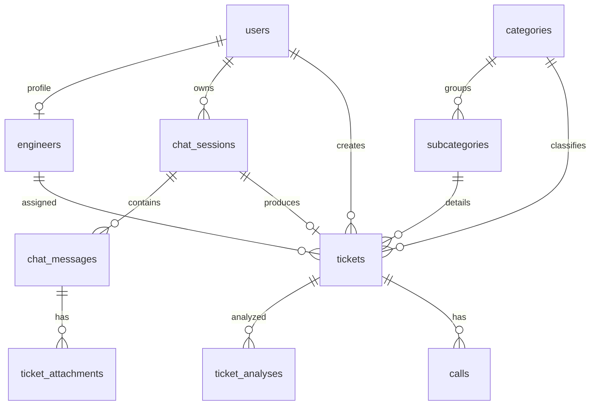

# DispatchAI — диспетчерская система с локальным ИИ

Приём обращений (чат, фото, звонки), структурированный ИИ-анализ и
заявки. Всё работает локально: Qwen3, Qwen3-VL, T-one и Silero TTS.

## Что работает

- **Заявки**: создание из чата/звонка, список, карточка, сообщения,
  вложения, категории, приоритет, назначение инженера.
- **ИИ-анализ**: текст → `TicketAIResult` (категория, локация, симптомы,
  выполненные действия, масштаб, приоритет, `missing_fields`, вопросы,
  уверенность, `needs_human_review`).
- **Изображения**: загрузка в БД, отдача через `/api/attachments/{id}/content`,
  описание локальной **Qwen3-VL** (Ollama).
- **Речь**: распознавание **T-one** (локальный HTTP-сервер), резерв —
  Whisper/Google; синтез **Silero TTS** (`/api/voice/tts`).
- **Браузерные звонки**: WebRTC-запись, локальная расшифровка T-one
  после звонка (live-субтитры — опционально), сохранение аудио и
  расшифровки, прослушивание с перемоткой (`Range`).
- **Телефония**: SIP-webhook и ARI (Asterisk).

## Архитектура данных

Схема следует ТЗ: семь основных таблиц — `users`, `engineers`,
`categories`, `subcategories`, `chat_sessions`, `chat_messages`,
`tickets` — плюс служебные `ticket_analyses`, `ticket_attachments`,
`ticket_events`, `knowledge_articles`, `ticket_kb_articles`, `calls`,
`call_transcript_segments`.



**Схема БД управляется только Alembic.** Приложение не вызывает
`create_all`: при старте выполняется `alembic upgrade head`. Модели
описаны в терминах PostgreSQL (`BIGINT`, `TEXT[]`, `JSONB`,
`TIMESTAMPTZ`), но за счёт `with_variant` те же модели и миграция
работают на SQLite для локальной разработки и тестов.

## Быстрый старт

### Backend

```bash
cd HEHEHEHA
python -m venv .venv
source .venv/bin/activate
pip install poetry
poetry install --no-root

cp backend/.env.example backend/.env
uvicorn backend.main:app --reload --port 8000
```

- Swagger: <http://localhost:8000/docs>
- Health и состояние моделей: <http://localhost:8000/api/health>
- По умолчанию SQLite `dispatcher.db`, схема создаётся Alembic.
- Для Postgres задайте `DATABASE_URL=postgresql+asyncpg://...`.

Миграции вручную:

```bash
alembic upgrade head
alembic current
alembic downgrade -1
```

> Если осталась БД со старой схемой, удалите `dispatcher.db` (SQLite) или
> пересоздайте volume Postgres: первый запуск накатит новую init-миграцию.

### Frontend

```bash
cd frontend
npm install
npm run dev
```

В dev фронтенд ходит на относительный `/api`; Vite проксирует его на
`http://localhost:8000` (`VITE_API_TARGET`). Для микрофона с другого
устройства используйте `npm run dev:https` и HTTPS-origin.

### Docker

```bash
docker compose up --build
```

Локальные модели — отдельными профилями:

```bash
docker compose --profile ollama up -d
docker compose exec ollama ollama pull qwen3:8b
docker compose exec ollama ollama pull qwen3-vl:8b
```

## Локальные модели

| Задача | Модель | Как подключить |
|---|---|---|
| Текст → JSON | Qwen3 (`qwen3:8b`) | Ollama, `OLLAMA_MODEL` |
| Картинки | Qwen3-VL (`qwen3-vl:8b`) | Ollama, `OLLAMA_VISION_MODEL` |
| Речь → текст | T-one | отдельный HTTP-сервер, `TONE_*` |
| Текст → речь | Silero TTS | `deploy/silero`, `SILERO_*` |

Ollama обслуживает только Qwen3 и Qwen3-VL. T-one и Silero TTS — это
отдельные серверы инференса, backend обращается к ним по HTTP.

**Полная пошаговая инструкция:** [`docs/local_models.md`](docs/local_models.md).
Готовый сервер Silero: [`deploy/silero/`](deploy/silero/).
Контракт для T-one: [`deploy/tone/README.md`](deploy/tone/README.md).

Минимум для текста и картинок:

```bash
ollama pull qwen3:8b
ollama pull qwen3-vl:8b
ollama serve
```

## Переменные окружения

Полный рабочий конфиг — в [`backend/.env.example`](backend/.env.example).

| Переменная | По умолчанию | Назначение |
|---|---|---|
| `DATABASE_URL` | `sqlite+aiosqlite:///./dispatcher.db` | DSN базы |
| `ALEMBIC_DATABASE_URL` | = `DATABASE_URL` | DSN для Alembic |
| `AI_PROVIDER` | `auto` | `auto` / `ollama` / `openai` / `gemini` / `rule` |
| `AI_AUTO_ANALYZE` | `true` | Анализ новой заявки сразу |
| `OLLAMA_BASE_URL` | `http://localhost:11434` | Ollama |
| `OLLAMA_MODEL` | `qwen3:8b` | Текстовая модель |
| `OLLAMA_THINK` | `false` | Отключить «размышления» Qwen3 |
| `VISION_PROVIDER` | `auto` | `auto` / `ollama` / `gemini` / `none` |
| `OLLAMA_VISION_MODEL` | `qwen3-vl:8b` | Vision-модель |
| `SPEECH_PROVIDER` | `auto` | `auto` / `tone` / `http` / `local` / `google` / `none` |
| `TONE_BASE_URL` | `http://localhost:8002` | Сервер T-one |
| `TONE_ENDPOINT` | `/audio/transcriptions` | Путь STT |
| `TTS_PROVIDER` | `silero` | `silero` / `none` |
| `SILERO_TTS_URL` | `http://localhost:8003` | Сервер Silero |
| `SILERO_SPEAKER` | `aidar` | Голос |
| `SIP_WEBHOOK_TOKEN` | — | Токен SIP-webhook'ов |
| `ARI_ENABLED` | `false` | ARI-клиент Asterisk |
| `MAX_UPLOAD_MB` | `30` | Лимит вложений |
| `MAX_AUDIO_MB` | `60` | Лимит аудио |

## API

| Метод | Путь | Назначение |
|---|---|---|
| `POST` | `/api/tickets` | Создать заявку (и сразу проанализировать) |
| `GET` | `/api/tickets` | Список заявок с фильтрами |
| `GET` | `/api/tickets/{id}` | Сообщения, вложения, звонки |
| `PATCH` | `/api/tickets/{id}` | Статус, приоритет, инженер |
| `POST` | `/api/tickets/{id}/assign` | Назначить инженера |
| `POST` | `/api/tickets/{id}/messages` | Сообщение (+вложения) |
| `POST` | `/api/tickets/{id}/attachments` | Загрузить фото/аудио |
| `POST` | `/api/tickets/{id}/analyze` | ИИ-анализ заявки |
| `GET` | `/api/attachments/{id}/content` | Отдать файл |
| `POST` | `/api/attachments/{id}/describe` | Описать фото (Qwen3-VL) |
| `GET` | `/api/calls` | Список звонков |
| `POST` | `/api/calls` | Создать сессию звонка |
| `POST` | `/api/calls/{id}/recording` | Загрузить запись |
| `GET` | `/api/calls/{id}/recording` | Прослушать (Range) |
| `PUT` | `/api/calls/{id}/transcript` | Сохранить расшифровку |
| `POST` | `/api/calls/{id}/transcribe` | T-one/Whisper/Google |
| `POST` | `/api/calls/{id}/analyze` | Анализ звонка → заявка |
| `WS` | `/api/calls/{id}/signal` | WebRTC + live-субтитры |
| `POST` | `/api/voice/transcribe` | Речь → текст (T-one) |
| `POST` | `/api/voice/tts` | Текст → речь (Silero) |
| `POST` | `/api/voice/chat` | Голосовой цикл T-one → Qwen3 → Silero |
| `GET` | `/api/voice/status` | Состояние STT/TTS/vision |
| `POST` | `/api/telephony/sip/calls` | SIP: звонок начался |
| `POST` | `/api/telephony/sip/calls/{id}/ended` | SIP: звонок завершён |
| `POST` | `/api/telephony/sip/recording` | SIP: загрузить запись |
| `GET` | `/api/users` | Пользователи/инженеры |
| `GET` | `/api/ai/taxonomy` | Справочники кодов |
| `POST` | `/api/ai/analyze-text` | Анализ текста без заявки |
| `GET` | `/api/health` | Состояние и модели |

SIP-эндпоинты требуют `X-Telephony-Token`.

## Тесты

```bash
python -m pytest backend/tests ai_module/tests -q
```

Покрыто: контракт ИИ, отсутствие галлюцинаций, массовая авария,
overrides диспетчера, полный цикл заявка → фото → звонок → расшифровка →
анализ, Range-аудио, SIP-webhook, ARI-поток, live-субтитры.

## Структура

```
backend/
  api/routes/      # tickets, attachments, calls, telephony, ai, users, voice
  core/            # settings, database (Alembic)
  models/          # по одной модели на файл, Base в core/database
  schemas/
  services/        # ai_service, call_service, transcription, ari, accounts, seed
  tests/
ai_module/
  core/            # taxonomy, schemas, analyzer, clarification, validator
  providers/       # Ollama (Qwen3), vision (Qwen3-VL), speech (T-one), tts
  tests/
frontend/
deploy/
  silero/          # локальный сервер Silero TTS
  tone/            # контракт и шаблон сервера T-one
  asterisk/        # dialplan
docs/
  local_models.md  # пошаговая инструкция
  telephony.md
migrations/         # Alembic (единственный источник схемы)
```

## Ограничения

- Нет авторизации: API открыт, роль заявителя — служебный пользователь.
- Файлы и аудио по умолчанию в БД: удобно для демо; для продакшена —
  S3/MinIO (поле `storage_path` для этого уже есть).
- In-memory WebRTC-сигналинг не масштабируется; для продакшена — Redis.
- T-one и Silero TTS требуют отдельных сервисов (см. документацию).

### Вход в локальное демо

При `SEED_DEMO_DATA=true` создаются следующие учётные записи. Пароль для
каждой демонстрационной записи — `demo-password`.

| Роль | Телефон |
| --- | --- |
| Клиент | +79994567890 |
| Диспетчер | +79991234567 |
| Инженер (сети) | +73213211212 |
| Инженер (оборудование) | +79992345678 |
| Инженер (ПО) | +79993456789 |
| Администратор | +79990000001 |

После входа сервер выдаёт HttpOnly cookie на восемь часов. Клиент видит
свои заявки, инженер — назначенные ему, диспетчер и администратор — общую
очередь. Для HTTPS включите `SESSION_COOKIE_SECURE=true`. Задайте общий
случайный `SESSION_SECRET` для нескольких процессов и сохранения сессий
после перезапуска. Используйте один origin для браузера и API через прокси.

Оценка SLA основана на приоритете: 2, 8, 24 или 72 часа с момента
создания. Риск появляется в последней четверти срока. Подбор инженера
учитывает компетенции и количество открытых назначений. База знаний
сопоставляет теги статей с категорией и подкатегорией анализа.

Миграция на телефон сохраняет идентификаторы пользователей и ссылки на них.
Для старых пользователей без известного номера задайте реальный телефон
перед входом. Прежний email хранится для отката миграции.
