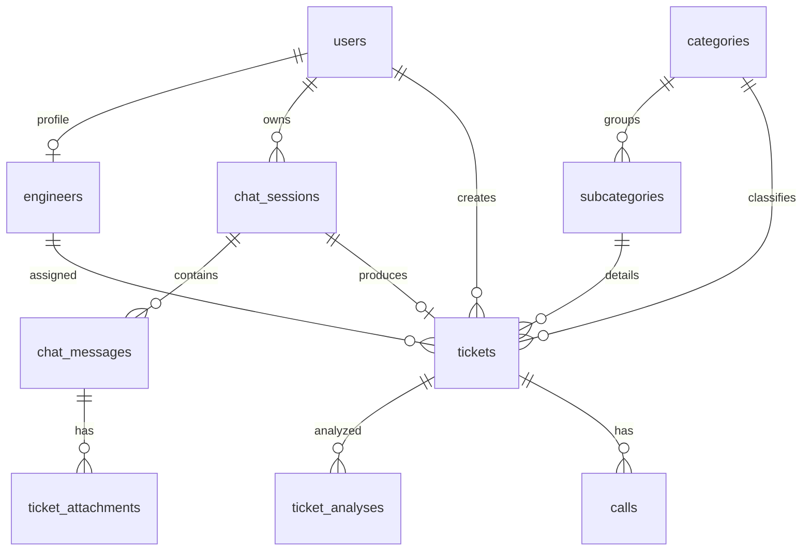

# Description — архитектура и инструменты DispatchAI

Описание того, из чего состоит проект, какие модели используются, в каком
порядке они вызываются и как устроены заявки, звонки и телефония.

---

## 1. Назначение

DispatchAI — диспетчерская система приёма ИТ-обращений:

- клиент пишет в чат, прикладывает фото или звонит;
- система распознаёт речь, текст и изображения;
- ИИ превращает обращение в структурированную заявку;
- диспетчер видит категорию, приоритет, недостающие поля и вопросы;
- инженер получает назначенную заявку.

Всё работает локально: Qwen3, Qwen3-VL, T-one и Silero TTS.

---

## 2. Технологический стек

| Слой | Технологии |
|---|---|
| Backend API | FastAPI, Uvicorn, Pydantic |
| ORM / БД | SQLAlchemy 2 (async), Alembic, SQLite / PostgreSQL |
| Аутентификация | `pwdlib` (Argon2) — хеши паролей; JWT/email-validator в резерве |
| ИИ-модуль | собственный `ai_module`, httpx, Pydantic |
| Локальные LLM | Ollama: Qwen3 (текст), Qwen3-VL (изображения) |
| STT | T-one (отдельный HTTP-сервер) |
| TTS | Silero TTS (отдельный HTTP-сервер на PyTorch) |
| Телефония | WebRTC, SIP-webhook, Asterisk ARI |
| Frontend | React 19, TypeScript, Vite, Tailwind, Zustand, Axios |

---

## 3. Структура backend

```
backend/
  api/routes/      # tickets, attachments, calls, telephony, ai, users, voice
  api/serializers.py
  core/            # settings.py, database.py (Alembic)
  models/          # по одной ORM-модели на файл
  schemas/         # Pydantic-схемы API
  services/        # ai_service, call_service, transcription, ari_service,
                   # accounts, seed, storage, signalling
  tests/
  requirements.txt
  Instruction.md
  Description.md
ai_module/
  core/            # analyzer, taxonomy, schemas, prompts, validator, clarification
  providers/       # text (Ollama), vision (Qwen3-VL), speech (T-one), tts (Silero)
  services/        # обёртки image/audio/ticket
  tests/
migrations/        # Alembic — единственный источник схемы
deploy/
  asterisk/        # ari.conf, http.conf, dialplan
  silero/          # tts_server.py
frontend/
```

Слои backend:

1. **routes** — HTTP/WebSocket-эндпоинты, валидация запросов.
2. **schemas** — Pydantic-контракты API.
3. **services** — бизнес-логика: ИИ, звонки, транскрибация, ARI, сиды.
4. **models** — SQLAlchemy-модели и ограничения БД.
5. **core** — настройки и подключение к БД.
6. **migrations** — версионирование схемы.

---

## 4. Модель данных

Схема ведётся Alembic. Модели описаны в терминах PostgreSQL
(`BIGINT`, `TEXT[]`, `JSONB`, `UUID`, `TIMESTAMPTZ`), но через
`with_variant` работают и на SQLite.

### 4.1. Основные таблицы

| Таблица | Назначение | Ключевые поля |
|---|---|---|
| `users` | сотрудники | `name`, `email` (уникальный lower-case), `password_hash`, `role`, `is_active` |
| `engineers` | профиль инженера | `user_id` (уникальный), `competencies TEXT[]`, `load`, `available` |
| `categories` | категории | `code` (уникальный), `name` |
| `subcategories` | подкатегории | `category_id`, `code`, `name`, уникальность `(category_id, code)` |
| `chat_sessions` | диалог до заявки | `id UUID`, `user_id`, `status`, `created_at`, `updated_at` |
| `chat_messages` | сообщения диалога | `session_id`, `role`, `content`, `created_at` |
| `tickets` | заявка | `chat_session_id` (уникальный), `created_by`, `raw_text`, `channel`, `status`, `category_id`, `subcategory_id`, `priority`, поля локации, массивы, флаги, инженеры, подтверждение |
| `ticket_analyses` | история ИИ-анализа | `chat_session_id`, `ticket_id`, `version`, `model_name`, `result JSONB`, `confidence` |
| `ticket_attachments` | вложения | `message_id`, `ticket_id`, `kind`, `file_name`, `storage_path`, `mime_type`, `file_size`, `sha256`, `description`, `data` |
| `ticket_events` | аудит изменений | `ticket_id`, `actor_id`, `action`, `field`, `old_value`, `new_value` |
| `knowledge_articles` | база знаний | `code`, `title`, `body`, `keywords TEXT[]` |
| `ticket_kb_articles` | рекомендации статей | `ticket_id`, `article_id`, `relevance_score` |
| `calls` | звонки | `ticket_id`, `external_id`, `transport`, `provider`, `client_phone`, `recording_data`, `transcript_*`, `ai_analysis` |
| `call_transcript_segments` | таймкоды расшифровки | `call_id`, `position`, `start_ms`, `end_ms`, `speaker`, `text`, `confidence` |

### 4.2. Роли и статусы

| Сущность | Допустимые значения |
|---|---|
| `users.role` | `requester`, `dispatcher`, `engineer` |
| `chat_sessions.status` | `active`, `completed`, `cancelled` |
| `chat_messages.role` | `user`, `assistant` |
| `tickets.status` | `draft`, `new`, `in_progress`, `resolved`, `closed` |
| `tickets.priority` | `low`, `medium`, `high`, `critical` (может быть `NULL`) |
| `tickets.channel` | `chat`, `voice`, `image` |
| `ticket_attachments.kind` | `image`, `audio`, `document` |
| `calls.status` | `ringing`, `active`, `completed`, `missed`, `failed` |

### 4.3. Связи



Важно: у `tickets` два внешних ключа на `users` (`created_by`,
`confirmed_by`) и два на `engineers` (`engineer_id`,
`recommended_engineer_id`), поэтому в ORM они заданы явно через
`foreign_keys`.

---

## 5. ИИ-модуль

### 5.1. Гибридный анализатор

Ключевая особенность: сначала **всегда** считается детерминированный
результат на правилах (`ai_module/core/analyzer.py`), затем поверх него
аккуратно накладывается ответ LLM.

Порядок:

1. `analyze_rule_based()` строит базовый `TicketAIResult`.
2. Если провайдер LLM доступен — модель получает промпт и возвращает JSON.
3. `validator.merge_payload()` проверяет коды категорий/симптомов, чистит
   ответ, нормализует типы.
4. `finalize_result()` пересчитывает `intake`, `missing_fields`,
   `requires_clarification`, `needs_human_review`.
5. `apply_operator_overrides()` применяет подтверждённые диспетчером поля.

Поэтому даже при недоступной модели система продолжает работать на
правилах. Это же позволяет использовать небольшие модели: они улучшают
результат, но не являются единственной точкой отказа.

### 5.2. Контракт `TicketAIResult`

```json
{
  "schema_version": "1.0",
  "ticket_id": "1",
  "intake": {
    "state": "collecting_info",
    "ready_for_dispatcher": false,
    "missing_fields": ["building", "ip_address"],
    "questions_to_client": [{"field": "building", "question": "..."}]
  },
  "classification": {
    "category_id": 1,
    "category_code": "network",
    "subcategory_id": 11,
    "subcategory_code": "no_internet",
    "status": "matched"
  },
  "extracted_fields": {
    "object": null,
    "location": {"building": null, "floor": null, "room": "305"},
    "device": "computer",
    "ip_address": null,
    "serial_number": null,
    "hostname": null
  },
  "issue": {
    "description": "...",
    "symptoms": ["no_internet"],
    "attempted_actions": ["reboot"],
    "impact": {
      "scope": "single_device",
      "affected_users_count": null,
      "service_unavailable": null
    }
  },
  "priority": {"suggested": "medium", "reasons": ["..."]},
  "confidence": {"classification": 0.7, "extraction": 0.6, "overall": 0.65},
  "requires_clarification": true,
  "needs_human_review": true,
  "decision_notes": ["..."],
  "visual_observations": []
}
```

`needs_human_review` выставляется при низкой уверенности, признаках
массовой аварии, `critical`/`needs_review` или неоднозначной
классификации.

### 5.3. Справочники

`ai_module/core/taxonomy.py` — единственный источник кодов:

- категории: `network`, `hardware`, `software`, `phone`, `access`, `other`;
- подкатегории (например, `no_internet`, `printer`, `password`);
- симптомы (`no_internet`, `blue_screen`, `no_audio`, ...);
- выполненные действия (`reboot`, `reconnect_cable`, ...);
- приоритеты и масштабы (`single_device`, `department`, `building`, ...).

При старте backend эти категории и подкатегории засеиваются в БД
(`backend/services/seed.py`), чтобы `tickets.category_id` ссылался на
справочник.

---

## 6. Локальные модели: что это и зачем

| Инструмент | Тип | Где работает | Роль |
|---|---|---|---|
| **Qwen3** | LLM | Ollama | текст → структурированный JSON |
| **Qwen3-VL** | vision-LLM | Ollama | описание изображений |
| **T-one** | ASR | отдельный HTTP-сервер | речь → текст (русский) |
| **Silero TTS** | TTS | отдельный HTTP-сервер | текст → речь |
| Ollama | runtime | локально | загрузка/выгрузка Qwen3 и Qwen3-VL |
| Whisper / Google | ASR | HTTP / облако | резерв для T-one |

> Ollama обслуживает **только** Qwen3 и Qwen3-VL. T-one и Silero TTS —
> отдельные модели со своим инференсом, backend общается с ними по HTTP.
> Автовыгрузка Ollama на них не распространяется.

### 6.1. Qwen3 (текст → JSON)

- Вызов: `POST {OLLAMA_BASE_URL}/api/chat`.
- Параметры: `stream=false`, `format=json`, `think=false`,
  `options.num_ctx`, `options.num_predict`, `keep_alive`.
- `think=false` отключает «размышления» Qwen3, чтобы получить чистый JSON.
- Модели: `qwen3:4b-instruct` (основная), `qwen3:1.7b` (быстрее),
  `qwen3:8b` (качественнее, но на CPU медленно).
- Провайдер: `ai_module/providers/text_provider.py`.

Промпт (`ai_module/core/prompts.py`) содержит справочник категорий,
симптомов, действий, историю сообщений, описания вложений и требования
к JSON.

### 6.2. Qwen3-VL (изображения)

- Вызов: тот же `/api/chat`, но в сообщении есть `images: [base64]`.
- Параметры: `think=false`, `num_ctx=4096`, `num_predict=256`.
- Модели: `qwen3-vl:2b` (основная), `qwen3-vl:4b` (лучше читает мелкий
  текст), `qwen3-vl:8b` (тяжело для 16 ГБ).
- Провайдер: `ai_module/providers/vision_provider.py`.

Изображение описывается 1–3 предложениями. Описание сохраняется в
`ticket_attachments.description` и затем попадает в текстовый анализ.

### 6.3. T-one (речь → текст)

- Русскоязычная ASR-модель от Т-Банка (open source).
- Backend отправляет аудио на `TONE_BASE_URL + TONE_ENDPOINT`
  (`/audio/transcriptions`) как `multipart/form-data`.
- Ожидаемый ответ: `{"text": "...", "language": "ru", "segments": [...]}`.
- Потоковый режим: `WS /api/voice/stream` → T-one `/ws/transcriptions`,
  PCM16LE mono 8 kHz, чанки 300 мс (2400 сэмплов), `finalize` в конце.
- Провайдер: `ai_module/providers/speech_provider.py`.
- Резерв: HTTP Whisper (`WHISPER_BASE_URL`), локальный `faster-whisper`,
  Google STT — по цепочке `auto`.

### 6.4. Silero TTS (текст → речь)

- Открытые модели Silero (`snakers4/silero-models`), загружаются через
  `torch.hub`.
- Сервер: `deploy/silero/tts_server.py` (FastAPI).
- `POST /tts` с JSON `{text, speaker, sample_rate}` → `audio/wav`.
- Голоса `v3_1_ru`: `aidar`, `baya`, `kseniya`, `xenia`, `eugene`.
- `TORCH_NUM_THREADS=2` ограничивает потоки, чтобы не конкурировать с
  Ollama на CPU.

### 6.5. Порядок вызова моделей

| Сценарий | Цепочка |
|---|---|
| Текстовая заявка | Qwen3 |
| Заявка с фото | Qwen3-VL (описание) → Qwen3 (анализ текста + описания) |
| Голосовое обращение | T-one → Qwen3 → Silero TTS |
| Звонок / SIP / ARI | T-one → Qwen3 (без TTS) |
| Без моделей | офлайн-правила `analyze_rule_based` |

Вызовы **последовательные**. На 16 ГБ достаточно держать одну модель
Ollama: при переходе от vision к тексту Ollama выгружает предыдущую.

### 6.6. Профиль для 16 ГБ / CPU

```env
OLLAMA_MAX_LOADED_MODELS=1
OLLAMA_NUM_PARALLEL=1
OLLAMA_KEEP_ALIVE=2m
OLLAMA_MODEL=qwen3:4b-instruct
OLLAMA_NUM_CTX=4096
OLLAMA_NUM_PREDICT=768
OLLAMA_VISION_MODEL=qwen3-vl:2b
OLLAMA_VISION_NUM_CTX=4096
OLLAMA_VISION_NUM_PREDICT=256
AI_TIMEOUT_SECONDS=300
VISION_TIMEOUT_SECONDS=240
```

`OLLAMA_MAX_LOADED_MODELS` и `OLLAMA_NUM_PARALLEL` — переменные **демона**
Ollama (systemd/окружение), а не backend.

### 6.7. Qdrant и база знаний

- Qdrant — векторная БД для семантического поиска статей (`knowledge_articles`).
- Эмбеддинги считает Ollama (`/api/embeddings`, модель `nomic-embed-text`).
- При старте backend индексирует статьи из `json/knowledge_articles.json`.
- Если Qdrant/эмбеддинги недоступны, используется keyword-поиск по БД.
- Рекомендации сохраняются в `ticket_kb_articles` и отдаются в `TicketDetail`.
- Переиндексация: `POST /api/knowledge/reindex`; состояние: `GET /api/knowledge/status`.

### 6.8. Статистика и чат

- `GET /api/stats` агрегирует заявки, приоритеты, категории, нагрузку
  инженеров, звонки, SLA-риски и почасовую активность. Используется
  админ-панелью.
- `POST /api/tickets/{id}/chat` сохраняет сообщение пользователя, генерирует
  ответ Qwen3 (с `/no_think`), сохраняет ответ ассистента и обновляет поля
  заявки rule-based анализом без второго вызова LLM.
- Страница `/knowledge` показывает статьи и поиск Qdrant; чат клиента
  использует реальные ответы модели, а не заготовки.

---

## 7. Как создаётся и анализируется заявка

1. `POST /api/tickets` создаёт `ChatSession`, `ChatMessage` и `Ticket`
   со статусом `draft`.
2. Если `auto_analyze` не отключён — запускается `analyze_ticket()`.
3. `build_analysis_request()` собирает:
   - сообщения `ChatMessage`;
   - расшифровки звонков `Call`;
   - вложения `TicketAttachment`;
   - справочник `taxonomy`.
4. `TicketAnalyzer` считает правило-базу и (если доступна) зовёт Qwen3.
5. Результат валидируется и сохраняется в `ticket_analyses`.
6. `Ticket` обновляется: `category_id`, `subcategory_id`, `priority`,
   `symptoms`, `attempted_actions`, `missing_fields`, `device`,
   `building`, `floor`, `room`, `host`, `is_mass_incident`,
   `needs_human_review`; статус `draft` → `new`.
7. Frontend получает `TicketAIResult` и показывает уточняющие вопросы.

Флаг `auto_analyze=false` позволяет фронтенду не запускать анализ при
создании, а вызвать `/analyze` один раз после добавления сообщения и
файла — так LLM не работает дважды.

---

## 8. Звонки

### 8.1. Браузерный WebRTC

1. `getUserMedia` получает микрофон, `MediaRecorder` пишет аудио.
2. `POST /api/calls` создаёт `Call`.
3. Запись загружается в `POST /api/calls/{id}/recording` (хранится в
   `calls.recording_data`).
4. Если браузерная расшифровка выключена, вызывается
   `POST /api/calls/{id}/transcribe` → T-one.
5. `POST /api/calls/{id}/analyze` создаёт/обновляет заявку через Qwen3.
6. WebSocket `/api/calls/{id}/signal` ретранслирует SDP/ICE и live-текст
   между клиентом и диспетчером.
7. После сохранения звонка frontend вызывает
   `POST /api/calls/{id}/voice-reply`; backend генерирует ответ Qwen3,
   синтезирует его Silero TTS и возвращает текст + base64-аудио.
   Ответ сохраняется в переписку заявки и проигрывается в виджете.

Live-субтитры браузера (Google Web Speech) **выключены по умолчанию**;
включаются `VITE_BROWSER_SPEECH=true`. Основная расшифровка — T-one.

### 8.2. SIP-webhook

АТС присылает события:

- `POST /api/telephony/sip/calls` — звонок начался;
- `POST /api/telephony/sip/calls/{external_id}/ended` — завершён
  (можно передать `recording_url`, backend скачает запись);
- `POST /api/telephony/sip/recording` — загрузка файла записи.

Все запросы требуют `X-Telephony-Token: <SIP_WEBHOOK_TOKEN>`. После
загрузки backend расшифровывает запись через T-one и запускает анализ.

### 8.3. Asterisk ARI

1. Входящий звонок уходит в `Stasis(dispatchai)`.
2. ARI присылает `StasisStart`; backend создаёт `Call`, отвечает на
   канал и запускает запись.
3. `RecordingFinished` → backend скачивает WAV через
   `GET /ari/recordings/stored/{name}/file`.
4. Запись сохраняется, расшифровывается T-one, анализируется Qwen3.
5. Создаётся/обновляется заявка (`channel=voice`).
6. `StasisEnd`/`ChannelDestroyed` фиксирует завершение и длительность.

### 8.4. Хранение

- `calls.recording_data` — аудио целиком в БД;
- `calls.transcript_text`, `recording_mime`, `recording_size`;
- `call_transcript_segments` — таймкоды;
- `GET /api/calls/{id}/recording` поддерживает `Range` (перемотка).

---

## 9. API

| Метод | Путь | Назначение |
|---|---|---|
| `POST` | `/api/tickets` | создать заявку (`auto_analyze` опционален) |
| `GET` | `/api/tickets` | список заявок |
| `GET` | `/api/tickets/{id}` | карточка заявки |
| `PATCH` | `/api/tickets/{id}` | обновить заявку |
| `POST` | `/api/tickets/{id}/assign` | назначить инженера |
| `POST` | `/api/tickets/{id}/auto-assign` | автоназначить по категории |
| `GET/POST` | `/api/tickets/{id}/messages` | сообщения |
| `GET/POST` | `/api/tickets/{id}/attachments` | вложения |
| `GET` | `/api/tickets/{id}/calls` | звонки заявки |
| `POST` | `/api/tickets/{id}/analyze` | ИИ-анализ |
| `POST` | `/api/tickets/{id}/chat` | сообщение + реальный ответ LLM |
| `POST` | `/api/tickets/{id}/chat/stream` | потоковый ответ LLM (SSE) |
| `GET` | `/api/attachments/{id}/content` | файл |
| `POST` | `/api/attachments/{id}/describe` | описать фото (Qwen3-VL) |
| `DELETE` | `/api/attachments/{id}` | удалить вложение |
| `GET/POST` | `/api/calls` | список/создание звонков |
| `GET/PATCH` | `/api/calls/{id}` | звонок, статус |
| `POST/GET` | `/api/calls/{id}/recording` | загрузить/прослушать запись |
| `PUT` | `/api/calls/{id}/transcript` | сохранить расшифровку |
| `POST` | `/api/calls/{id}/transcribe` | T-one/Whisper/Google |
| `POST` | `/api/calls/{id}/analyze` | анализ звонка |
| `POST` | `/api/calls/{id}/voice-reply` | голосовой ответ ИИ на звонок |
| `WS` | `/api/calls/{id}/signal` | WebRTC + live-текст |
| `POST` | `/api/voice/transcribe` | речь → текст |
| `POST` | `/api/voice/tts` | текст → речь |
| `POST` | `/api/voice/chat` | T-one → Qwen3 → Silero |
| `WS` | `/api/voice/stream` | потоковый T-one (PCM16LE 8k, 300 мс) |
| `GET` | `/api/voice/status` | статус STT/TTS/vision |
| `POST` | `/api/telephony/sip/calls` | SIP: старт |
| `POST` | `/api/telephony/sip/calls/{id}/ended` | SIP: завершение |
| `POST` | `/api/telephony/sip/recording` | SIP: запись |
| `GET` | `/api/telephony/sip/calls/{id}` | SIP: состояние |
| `GET` | `/api/users` | пользователи/инженеры |
| `GET` | `/api/ai/taxonomy` | справочник кодов |
| `POST` | `/api/ai/analyze-text` | анализ без заявки |
| `GET` | `/api/ai/tickets/{id}` | сохранённый анализ |
| `GET` | `/api/stats` | агрегированная статистика |
| `GET` | `/api/knowledge/articles` | статьи базы знаний |
| `GET` | `/api/knowledge/search` | семантический поиск |
| `GET` | `/api/knowledge/status` | состояние Qdrant |
| `POST` | `/api/knowledge/reindex` | переиндексация Qdrant |
| `GET` | `/api/health` | состояние и модели |

SIP-эндпоинты защищены `X-Telephony-Token`.

---

## 10. Frontend

- React 19 + TypeScript + Vite + Tailwind.
- Страницы: логин, чат клиента, панель диспетчера, звонки, заявки,
  инженер, админ-дашборд.
- Чат и звонки работают с реальным API; часть страниц заявок использует
  mock/localStorage.
- Состояние авторизации — Zustand (демо, без backend-аутентификации).
- `VITE_API_URL` задаёт адрес backend; в dev Vite проксирует `/api`.
- `VITE_BROWSER_SPEECH=true` включает браузерные live-субтитры.

---

## 11. Конфигурация

Все переменные — в `backend/.env.example`. Группы:

| Группа | Переменные |
|---|---|
| БД | `DATABASE_URL`, `ALEMBIC_DATABASE_URL` |
| Приложение | `APP_NAME`, `CORS_ORIGINS`, `SEED_DEMO_DATA`, `MAX_UPLOAD_MB`, `MAX_AUDIO_MB` |
| Текст | `AI_PROVIDER`, `AI_AUTO_ANALYZE`, `AI_TIMEOUT_SECONDS`, `OLLAMA_*`, `OPENAI_*`, `GEMINI_*` |
| Vision | `VISION_PROVIDER`, `OLLAMA_VISION_*`, `GEMINI_VISION_MODEL`, `VISION_TIMEOUT_SECONDS` |
| STT | `SPEECH_PROVIDER`, `TONE_*`, `WHISPER_*`, `GOOGLE_STT_LANGUAGE` |
| TTS | `TTS_PROVIDER`, `TTS_ENABLED`, `SILERO_*` |
| Телефония | `SIP_WEBHOOK_TOKEN`, `SIP_AUTO_ANALYZE`, `ARI_*` |

`AI_PROVIDER=auto` — локальная Ollama, при недоступности офлайн-правила.
`SPEECH_PROVIDER=auto` — T-one → Whisper HTTP → faster-whisper → Google.

---

## 12. Ограничения текущей версии

- Нет backend-аутентификации: API открыт, заявки создаёт служебный
  пользователь-заявитель.
- Файлы и аудио по умолчанию хранятся в БД (`data`), для продакшена
  предусмотрено поле `storage_path` (S3/MinIO).
- WebRTC-сигналинг in-memory: не переживает перезапуск и не
  масштабируется горизонтально.
- T-one и Silero TTS требуют отдельных сервисов; Asterisk — отдельной
  АТС.
- На CPU инференс последовательный и заметно медленнее GPU; для 16 ГБ
  рекомендован профиль 4B + 2B.
- In-memory live-субтитры браузера зависят от Chrome/Edge и Google Web
  Speech; по умолчанию используется локальный T-one после звонка.
