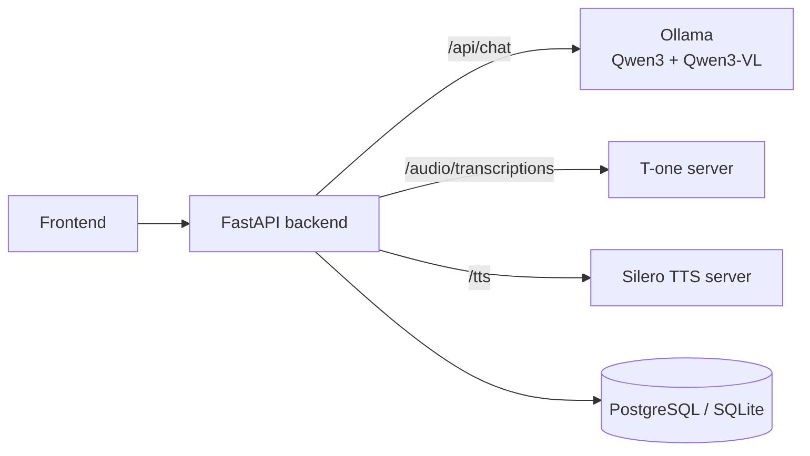

# Локальные ИИ-модели: пошаговая инструкция

Система работает полностью локально, без Google и платных API.

| Задача | Модель | Как запускается | Переменные |
|---|---|---|---|
| Текст → структурированный JSON | **Qwen3** | Ollama | `OLLAMA_MODEL` |
| Распознавание изображений | **Qwen3-VL** | Ollama | `OLLAMA_VISION_MODEL` |
| Распознавание речи (STT) | **T-one** | отдельный HTTP-сервер | `TONE_*` |
| Синтез речи (TTS) | **Silero TTS** | отдельный HTTP-сервер | `SILERO_*` |

> **Важно.** Ollama умеет обслуживать только LLM и vision-модели
> (Qwen3, Qwen3-VL). T-one и Silero TTS — это отдельные модели со своим
> инференсом, их нельзя «загрузить в Ollama». Для них поднимаются
> небольшие HTTP-сервисы, а backend обращается к ним по HTTP.

Схема взаимодействия:



---

## 0. Что подготовить заранее

- Python **3.13+** — для backend.
- Ollama **0.9+** — для Qwen3 и Qwen3-VL.
- Для GPU: драйвер NVIDIA + CUDA (для Ollama — `nvidia-container-toolkit`,
  если Ollama в Docker).
- Свободное место: Qwen3 8B ≈ 5 ГБ, Qwen3-VL 8B ≈ 6 ГБ, Silero TTS ≈ 1 ГБ.

Ориентиры по видеопамяти (квантование Q4):

| Модель | VRAM | Когда выбирать |
|---|---|---|
| `qwen3:4b` | ~4 ГБ | слабая машина / CPU |
| `qwen3:8b` | ~7 ГБ | рекомендуемый баланс |
| `qwen3:14b` | ~11 ГБ | качество выше, 12+ ГБ VRAM |
| `qwen3:32b` | ~22 ГБ | максимум качества, 24 ГБ VRAM |
| `qwen3-vl:8b` | ~8 ГБ | изображения |

На CPU всё тоже работает, но медленнее (первый ответ — десятки секунд).

---

## 1. Ollama

### 1.1 Установка

**Linux / macOS:**

```bash
curl -fsSL https://ollama.com/install.sh | sh
```

**Проверка:**

```bash
ollama --version
curl -s http://localhost:11434/api/tags
```

Если сервер не стартовал сам:

```bash
ollama serve
```

`ollama serve` открывает `http://127.0.0.1:11434`. Если backend в Docker,
а Ollama на хосте, либо запускайте Ollama в Docker (см. 1.4), либо
разрешите доступ снаружи:

```bash
OLLAMA_HOST=0.0.0.0:11434 ollama serve
```

### 1.2 Qwen3 — текст → JSON

Скачайте модель (один раз):

```bash
ollama pull qwen3:8b
```

Проверка, что модель отвечает:

```bash
ollama run qwen3:8b "Ответь одним словом: ok"
ollama list
```

Проверка JSON-режима (именно так backend вызывает модель):

```bash
curl -s http://localhost:11434/api/chat -d '{
  "model": "qwen3:8b",
  "stream": false,
  "format": "json",
  "think": false,
  "messages": [
    {"role": "user", "content": "Верни JSON {\"ok\": true}"}
  ]
}'
```

В ответе будет `message.content` — строка с JSON.

Укажите в `backend/.env`:

```env
AI_PROVIDER=auto          # auto = Ollama, если она доступна
OLLAMA_BASE_URL=http://localhost:11434
OLLAMA_MODEL=qwen3:8b
OLLAMA_THINK=false        # Qwen3 не должен «размышлять» вокруг JSON
OLLAMA_NUM_CTX=8192
OLLAMA_NUM_PREDICT=1024
```

`OLLAMA_THINK=false` важен: иначе Qwen3 может вернуть рассуждения до/после
JSON. Backend и так вырезает JSON из ответа, но с `false` стабильнее.

Другие варианты модели: `qwen3:4b`, `qwen3:14b`, `qwen3:32b`,
`qwen3:30b-a3b` (MoE, быстрее при большом качестве).

### 1.3 Qwen3-VL — изображения

```bash
ollama pull qwen3-vl:8b
```

Проверка через API (изображение передаётся base64 в поле `images`):

```bash
IMG=$(base64 -w0 screenshot.png)
curl -s http://localhost:11434/api/chat -d "{
  \"model\": \"qwen3-vl:8b\",
  \"stream\": false,
  \"think\": false,
  \"messages\": [{
    \"role\": \"user\",
    \"content\": \"Опиши неисправность на изображении по-русски\",
    \"images\": [\"$IMG\"]
  }]
}"
```

В `backend/.env`:

```env
VISION_PROVIDER=auto
OLLAMA_VISION_MODEL=qwen3-vl:8b
VISION_TIMEOUT_SECONDS=120
```

Проверка через приложение:

```bash
# 1. создайте заявку и узнайте её id
curl -s -X POST http://localhost:8000/api/tickets \
  -H 'Content-Type: application/json' \
  -d '{"description":"Не работает принтер","source":"chat"}'

# 2. загрузите фото
curl -s -X POST http://localhost:8000/api/tickets/1/attachments \
  -F file=@screen.png

# 3. попросите описание
curl -s -X POST http://localhost:8000/api/attachments/1/describe
```

### 1.4 Ollama в Docker (альтернатива)

В репозитории уже есть профиль `ollama`:

```bash
docker compose --profile ollama up -d
docker compose exec ollama ollama pull qwen3:8b
docker compose exec ollama ollama pull qwen3-vl:8b
docker compose exec ollama ollama list
```

В `docker-compose.yml` у сервиса `web` уже задано
`OLLAMA_BASE_URL=http://ollama:11434`. Если backend запускается на хосте,
оставьте `http://localhost:11434`.

---

## 2. T-one — распознавание речи (STT)

T-one — русскоязычная ASR-модель от Т-Банка (open source). Она **не**
входит в Ollama. Backend обращается к ней как к HTTP-серверу,
совместимому с OpenAI `/audio/transcriptions`.

### 2.1 Контракт сервера

Сервер должен принимать `multipart/form-data`:

| Поле | Значение |
|---|---|
| `file` (или `TONE_FILE_FIELD`) | аудиофайл |
| `model` | `t-one` |
| `language` | `ru` |
| `response_format` | `verbose_json` |

И возвращать JSON:

```json
{
  "text": "распознанный текст",
  "language": "ru",
  "segments": [
    {"start": 0.0, "end": 2.4, "text": "первый фрагмент"}
  ]
}
```

Достаточно и `{"text": "..."}` — `segments` опциональны.

### 2.2 Запуск

1. Склонируйте официальный репозиторий T-one и установите зависимости
   по его README (PyTorch + веса модели).
2. Оберните инференс в HTTP-сервер с контрактом выше. Готовый шаблон —
   `deploy/tone/README.md`.
3. Запустите его на порту `8002`:

```bash
uvicorn server:app --host 0.0.0.0 --port 8002
```

4. Проверьте:

```bash
curl -s http://localhost:8002/audio/transcriptions \
  -F file=@sample.wav \
  -F model=t-one \
  -F language=ru \
  -F response_format=verbose_json
```

5. В `backend/.env`:

```env
SPEECH_PROVIDER=auto        # tone -> whisper-http -> local -> google
TONE_BASE_URL=http://localhost:8002
TONE_MODEL=t-one
TONE_ENDPOINT=/audio/transcriptions
TONE_FILE_FIELD=file
TONE_LANGUAGE=ru
TONE_TIMEOUT_SECONDS=120
```

6. Проверка через приложение:

```bash
curl -s -X POST http://localhost:8000/api/voice/transcribe \
  -F file=@sample.wav \
  -F language=ru-RU
```

Если ваш сервер T-one уже отдаёт OpenAI-совместимый API, обёртка не
нужна — просто укажите его адрес в `TONE_BASE_URL`.

### 2.3 Резервные варианты

`SPEECH_PROVIDER=auto` перебирает настроенные провайдеры по порядку:
`tone → whisper-http → faster-whisper (local) → google`. Пока T-one не
поднят, можно временно использовать Whisper:

```bash
docker compose --profile whisper up -d
```

```env
WHISPER_BASE_URL=http://localhost:8001/v1
```

---

## 3. Silero TTS — синтез речи

Silero TTS тоже запускается отдельным сервером. В репозитории есть
готовый сервер: `deploy/silero/tts_server.py`.

### 3.1 Установка

```bash
cd deploy/silero
python -m venv .venv
source .venv/bin/activate
pip install -r requirements.txt
```

Для GPU установите PyTorch с CUDA по инструкции с <https://pytorch.org>.

Первый запуск скачает модель с `torch.hub` (нужен интернет один раз).

### 3.2 Запуск

```bash
uvicorn tts_server:app --host 0.0.0.0 --port 8003
```

Проверка:

```bash
curl -s -X POST http://localhost:8003/tts \
  -H 'Content-Type: application/json' \
  -d '{"text":"Здравствуйте! Чем могу помочь?","speaker":"aidar"}' \
  --output speech.wav

file speech.wav   # WAV audio
```

### 3.3 Настройка backend

```env
TTS_PROVIDER=silero
TTS_ENABLED=true
SILERO_TTS_URL=http://localhost:8003
SILERO_TTS_ENDPOINT=/tts
SILERO_SPEAKER=aidar
SILERO_LANGUAGE=ru
SILERO_SAMPLE_RATE=48000
```

Проверка через приложение:

```bash
curl -s -X POST http://localhost:8000/api/voice/tts \
  -H 'Content-Type: application/json' \
  -d '{"text":"Здравствуйте! Опишите проблему."}' \
  --output reply.wav
```

Голоса Silero (`v3_1_ru`): `aidar`, `baya`, `kseniya`, `xenia`, `eugene`,
`random`. Список зависит от версии модели.

---

## 4. Порядок запуска (кратко)

```bash
# 1. Ollama + модели
ollama serve &
ollama pull qwen3:8b
ollama pull qwen3-vl:8b

# 2. T-one (свой сервер по контракту)
uvicorn server:app --port 8002 &

# 3. Silero TTS
cd deploy/silero && uvicorn tts_server:app --port 8003 &

# 4. Backend
cd HEHEHEHA
cp backend/.env.example backend/.env
uvicorn backend.main:app --reload --port 8000
```

Схема БД создаётся автоматически: при старте backend выполняет
`alembic upgrade head`. Вручную:

```bash
alembic upgrade head
alembic current
```

---

## 5. Проверка, что всё подключено

```bash
curl -s http://localhost:8000/api/health | python -m json.tool
```

Ожидаемые поля:

```json
{
  "status": "ok",
  "ai_provider": "auto",
  "ai_model": "qwen3:8b",
  "speech": {"tone": true, "providers": ["tone"]},
  "vision": {"ollama_vision_model": "qwen3-vl:8b"},
  "tts": {"provider": "silero", "silero_url": "http://localhost:8003"}
}
```

Функциональные проверки:

```bash
# текст -> JSON
curl -s -X POST http://localhost:8000/api/ai/analyze-text \
  -H 'Content-Type: application/json' \
  -d '{"text":"В 305 кабинете не работает интернет, перезагрузка не помогла"}'

# речь -> текст
curl -s -X POST http://localhost:8000/api/voice/transcribe -F file=@sample.wav

# текст -> речь
curl -s -X POST http://localhost:8000/api/voice/tts \
  -H 'Content-Type: application/json' \
  -d '{"text":"Проверка синтеза речи"}' --output out.wav

# полный голосовой цикл: T-one -> Qwen3 -> Silero
curl -s -X POST http://localhost:8000/api/voice/chat \
  -F file=@sample.wav \
  -F language=ru-RU | python -m json.tool
```

---

## 6. Диагностика проблем

| Симптом | Причина / решение |
|---|---|
| `backend` пишет «офлайн-анализ» | Ollama не отвечает. `ollama list`, `curl localhost:11434/api/tags`, проверьте `OLLAMA_BASE_URL`. |
| `model "qwen3:8b" not found` | Не выполнен `ollama pull qwen3:8b`. |
| Qwen3 возвращает не JSON | `OLLAMA_THINK=false`, `format: json`, уменьшите `temperature`. Backend всё равно нормализует ответ. |
| Модель падает / OOM | Возьмите модель меньше (`qwen3:4b`, `qwen3-vl:2b`), закройте другие GPU-процессы. |
| Первый ответ очень долгий | Модель грузится в память. Дальше работает `OLLAMA_KEEP_ALIVE=5m`. |
| Backend в Docker не видит Ollama на хосте | Используйте профиль `ollama` в compose или `host.docker.internal` (`extra_hosts` уже настроен). |
| T-one 503 | Сервер не запущен / неверный `TONE_BASE_URL`/`TONE_ENDPOINT`. Проверьте curl напрямую. |
| TTS 503 | `SILERO_TTS_URL` пуст, `TTS_ENABLED=false` или сервер не отвечает. |
| Микрофон не работает в браузере | Нужен Chrome/Edge и secure context (`localhost` или HTTPS). |
| `alembic: table already exists` | Осталась старая БД. Удалите `dispatcher.db` (SQLite) или пересоздайте volume Postgres. |

---

## 7. Полностью локальный режим

```env
AI_PROVIDER=ollama
VISION_PROVIDER=ollama
SPEECH_PROVIDER=tone
TTS_PROVIDER=silero
GOOGLE_API_KEY=
GEMINI_API_KEY=
```

Ни один запрос не уходит в интернет (кроме первичной загрузки моделей).
